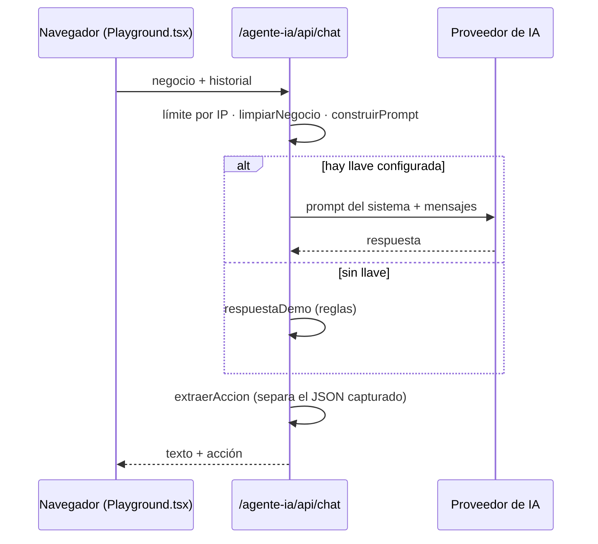

<div align="center">

# 💬 Agente IA Playground

**Diseña y prueba un agente de atención con IA para tu negocio, en un chat estilo WhatsApp.**

Configura los datos del negocio, chatea como si fueras un cliente y obtén los datos capturados listos para tu CRM.

[](https://nextjs.org)
[](https://www.typescriptlang.org)
[](https://tailwindcss.com)
[](https://vercel.com)

🌐 **[herramientas.totalsecuritysh.com/agente-ia](https://herramientas.totalsecuritysh.com/agente-ia)**

</div>

## ✨ Funcionalidades

| | |
|---|---|
| 🏪 **Plantillas por giro** | Clínica dental, taller mecánico, restaurante e inmobiliaria, editables. |
| 🧾 **Conocimiento acotado** | El agente responde solo con el horario, ubicación, servicios, precios y reglas que configuras. |
| 🎭 **Tono** | Amable, formal o directo. |
| 🎯 **Objetivo** | Agendar cita, tomar pedido o calificar prospecto. Pide los datos uno por uno. |
| 📦 **Captura estructurada** | Al terminar, entrega nombre, teléfono y demás campos en JSON, listos para un CRM, Google Sheets o n8n. |
| 🔍 **Prompt visible** | Muestra el prompt del sistema que recibe el modelo, útil para aprender a diseñar agentes. |
| 💸 **Control de gasto** | Límite de mensajes por IP y por conversación, respuestas cortas y textos recortados en el servidor. |
| 🧪 **Modo demostración** | Sin llave de IA, responde con reglas para que la herramienta siempre funcione. |

## 🏗️ Arquitectura



```
src/
├── app/
│   ├── page.tsx              portada y playground (basePath /agente-ia)
│   └── api/chat/route.ts     validación, límites y llamada al modelo
├── components/
│   └── Playground.tsx        configuración, chat y datos capturados
└── lib/
    ├── negocio.ts            tipos, plantillas, prompt y extracción de la acción
    ├── llm.ts                cliente OpenAI / Anthropic con fetch, sin SDK
    └── demo.ts               agente por reglas para el modo demostración
```

### ¿Cómo entrega datos estructurados?
El prompt le pide al modelo que, al confirmar todos los datos, agregue una línea `<<ACCION {...}>>`. El servidor la separa del texto visible, valida los campos esperados y la devuelve aparte. El cliente nunca ve esa línea.

### Seguridad
- El prompt se arma **en el servidor**: el navegador solo envía los datos del negocio, recortados a longitudes máximas. Así la API no sirve como acceso libre al modelo.
- La llave de IA vive en variables de entorno de Vercel y nunca llega al navegador.
- Los errores del proveedor se registran en el servidor; al usuario solo le llega un mensaje genérico.

### Multi-zones
Esta herramienta es una **zona** del hub [`tsh-herramientas`](https://github.com/TotalSecurity-SH/tsh-herramientas). Se publica con `basePath: "/agente-ia"` en su propio proyecto de Vercel y el hub la sirve en `herramientas.totalsecuritysh.com/agente-ia` mediante *rewrites*. Cada herramienta vive en su propio repo, pero el usuario ve una sola plataforma.

## 🔑 Variables de entorno

| Variable | Descripción |
|---|---|
| `OPENAI_API_KEY` o `ANTHROPIC_API_KEY` | Llave del proveedor. Sin llave, la herramienta corre en modo demostración. |
| `LLM_PROVIDER` | Opcional: `openai` o `anthropic` si configuras ambas llaves. |
| `LLM_MODEL` | Opcional: modelo a usar. Por defecto `gpt-4o-mini` o `claude-haiku-5-5`. |
| `AGENTE_LIMITE` | Mensajes por IP cada 10 minutos. Por defecto 30. |
| `AGENTE_DEMO` | `1` para forzar el modo demostración. |

> Configura también un **límite de gasto mensual** en el panel de tu proveedor de IA. El límite por IP es por instancia y no sustituye a ese tope.

## 🚀 Correr en local

```bash
git clone https://github.com/TotalSecurity-SH/agente-ia-playground.git
cd agente-ia-playground
npm install
cp .env.example .env.local   # agrega tu llave o déjalo vacío para modo demostración
npm run dev
```

Abre http://localhost:3000/agente-ia

## ☁️ Desplegar en Vercel

1. Importa el repositorio en [vercel.com/new](https://vercel.com/new). Framework: **Next.js**.
2. En **Settings → Environment Variables** agrega la llave del proveedor y, si quieres, `AGENTE_LIMITE`.
3. **Deploy**. Queda en `https://<proyecto>.vercel.app/agente-ia`.
4. En el proyecto del hub, define `AGENTE_IA_URL` con esa URL y vuelve a desplegar el hub.

<div align="center">

Hecho por **[Carlos Santiago](https://carlossantiago.totalsecuritysh.com)** · [Total Security SH](https://totalsecuritysh.com) · Full Stack Developer · IA y Automatización

</div>
